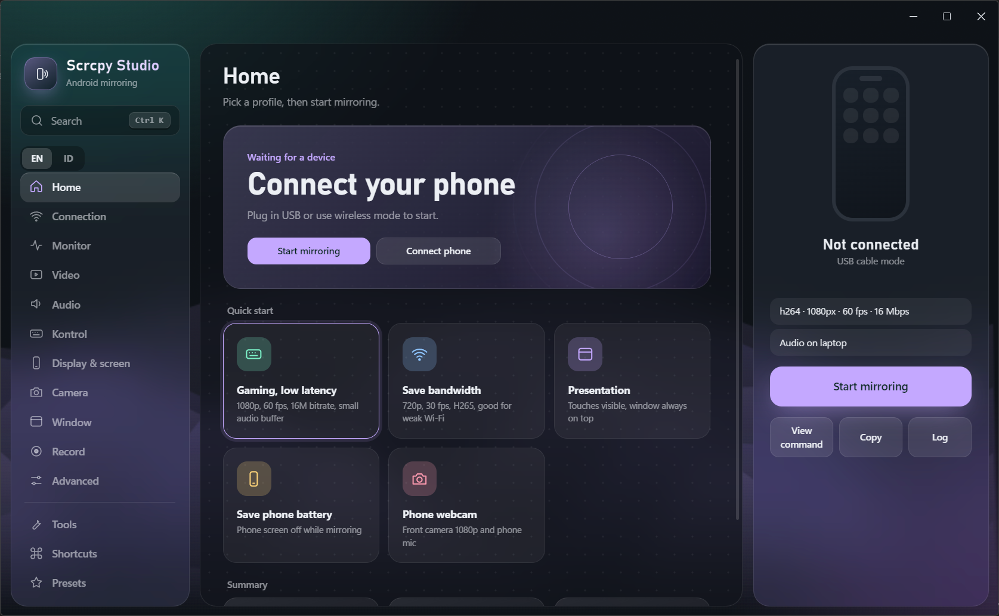
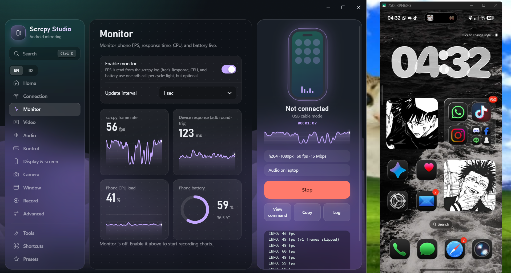
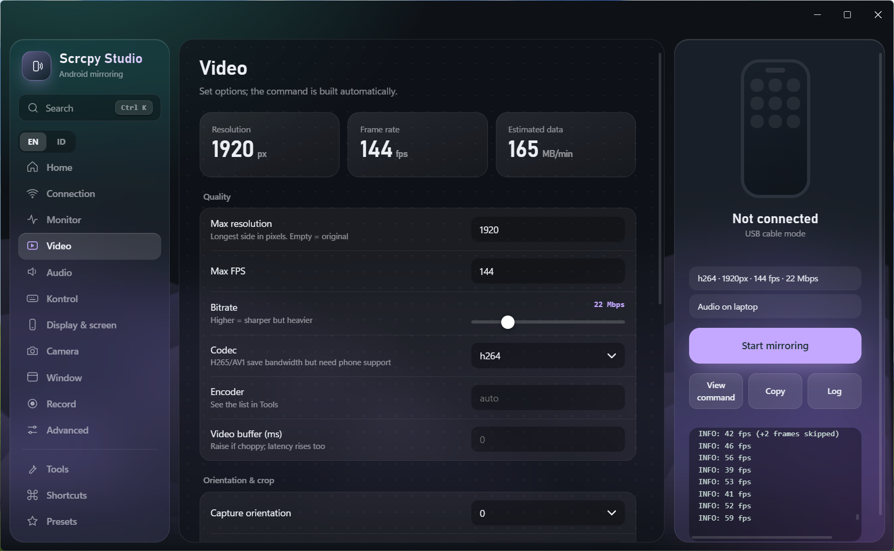

# Scrcpy Studio

[English](README.md) | **Bahasa Indonesia**

GUI desktop premium untuk [scrcpy](https://github.com/Genymobile/scrcpy). Mirror dan kontrol HP Android lewat USB atau Wi-Fi tanpa mengetik command.

Dibuat untuk **scrcpy 5.0.x**. Windows, Electron.

## Fitur
- **Kabel dan wireless**: Connect, Pair (kode pairing Android 11+), dan USB ke Wi-Fi (`adb tcpip`) dengan deteksi IP otomatis dan riwayat IP.
- **Hampir semua opsi scrcpy** sebagai toggle, dropdown, dan slider: video, audio, input (keyboard, mouse, gamepad, OTG), display virtual, kamera, jendela, rekam, lanjutan.
- **Pengaturan audio**: laptop saja, HP + laptop (duplikat), HP saja, mic HP, atau sumber kustom.
- **Preview command live** supaya tetap belajar syntax, dengan salin satu klik.
- **Monitor live** (opsional): grafik FPS, respons perangkat, CPU, dan baterai.
- **Preset**: 5 profil bawaan (gaming, hemat bandwidth, presentasi, hemat baterai, webcam HP) plus buatanmu sendiri.
- **Command palette** (`Ctrl+K`), daftar shortcut, screenshot, pasang APK, daftar perangkat dan encoder.
- UI kaca dengan latar bergerak, warna aksen, dan **English / Bahasa Indonesia** (ganti di sidebar).

## Instalasi
Unduh `Scrcpy Studio-Setup-x.y.z.exe` terbaru (atau versi Portable) dari [Releases](../../releases).

Saat pertama dibuka, pilih folder scrcpy (yang berisi `scrcpy.exe` dan `adb.exe`). Unduh scrcpy dari [rilis resminya](https://github.com/Genymobile/scrcpy/releases).

> Windows SmartScreen bisa memperingatkan "unknown publisher" karena aplikasi belum ditandatangani. Klik **More info**, lalu **Run anyway**.

## Jalankan dari source
    npm install
    npm start

## Membuat .exe
Lihat [BUILD.id.md](BUILD.id.md).

## Screenshot

## Catatan
- "Respons perangkat" di monitor adalah waktu round-trip adb, bukan latensi video.
- Duplikat audio butuh Android yang cukup baru (umumnya 13+) dan aplikasi yang didukung.

## Lisensi
[MIT](LICENSE). scrcpy berlisensi terpisah oleh Genymobile (Apache 2.0).
