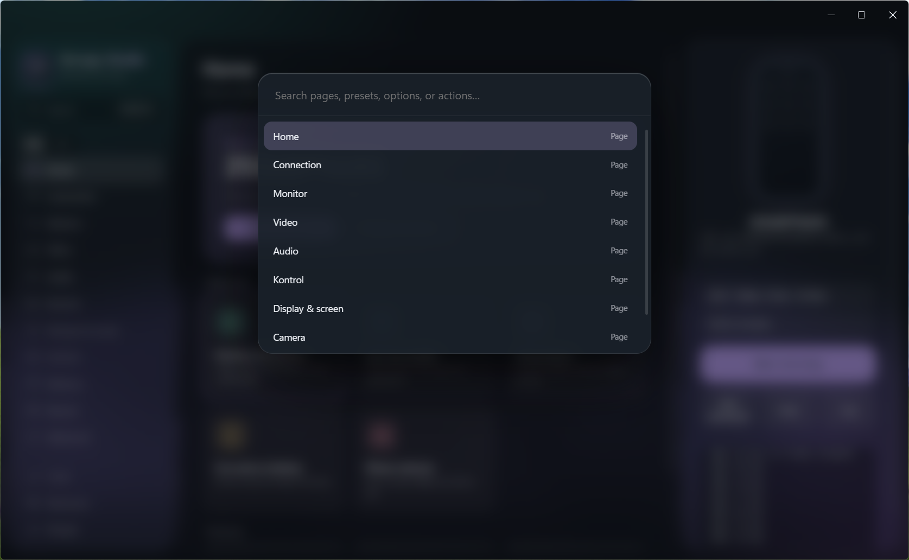

# Scrcpy Studio

**English** | [Bahasa Indonesia](README.id.md)

A premium desktop GUI for [scrcpy](https://github.com/Genymobile/scrcpy). Mirror and control your Android phone over USB or Wi-Fi without ever typing a command.

Built for **scrcpy 5.0.x**. Windows, Electron.

## Features
- **Wired and wireless**: Connect, Pair (Android 11+ pairing code), and USB-to-Wi-Fi (`adb tcpip`) with automatic IP detection and IP history.
- **Nearly every scrcpy option** as toggles, dropdowns, and sliders: video, audio, input (keyboard, mouse, gamepad, OTG), virtual display, camera, window, recording, advanced.
- **Audio routing**: laptop only, phone + laptop (duplicate), phone only, phone mic, or custom source.
- **Live command preview** so you still learn the syntax, with one-click copy.
- **Live monitor** (optional): FPS, device response time, CPU, and battery charts.
- **Presets**: 5 built-in profiles (gaming, low bandwidth, presentation, battery saver, phone webcam) plus your own.
- **Command palette** (`Ctrl+K`), shortcuts cheat sheet, screenshot, APK install, device and encoder lists.
- Glass UI with animated background, accent colors, and **English / Bahasa Indonesia** (switch in the sidebar).

## Install
Download the latest `Scrcpy Studio-Setup-x.y.z.exe` (or the Portable build) from [Releases](../../releases).

On first launch, choose your scrcpy folder (the one containing `scrcpy.exe` and `adb.exe`). Download scrcpy from the [official releases](https://github.com/Genymobile/scrcpy/releases).

> Windows SmartScreen may warn about an unknown publisher because the app is unsigned. Click **More info**, then **Run anyway**.

## Run from source
    npm install
    npm start

## Build the .exe
See [BUILD.md](BUILD.md).

## Screenshots

## Notes
- "Device response" in the monitor is the adb round-trip time, not video latency.
- Audio duplication needs a recent Android (usually 13+) and a supported app.

## License
[MIT](LICENSE). scrcpy is licensed separately by Genymobile under Apache 2.0.
